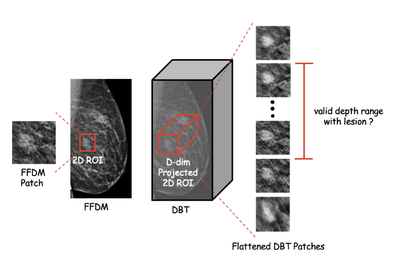
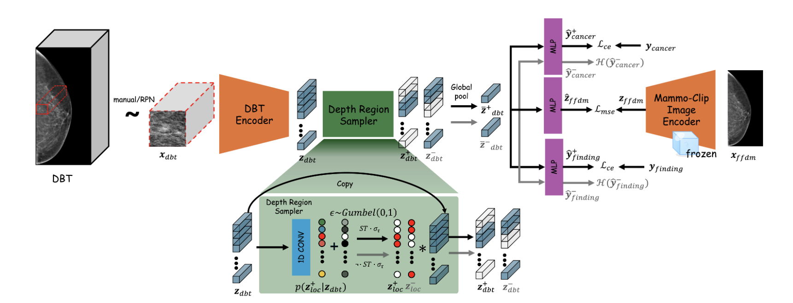
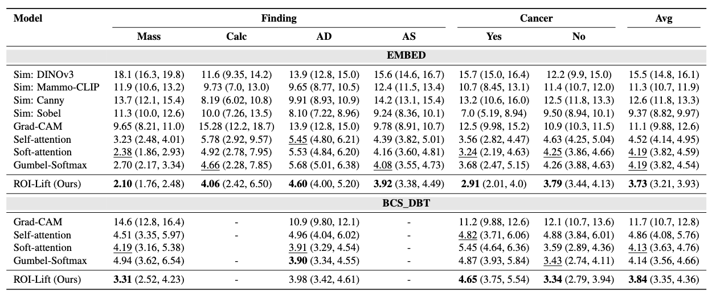
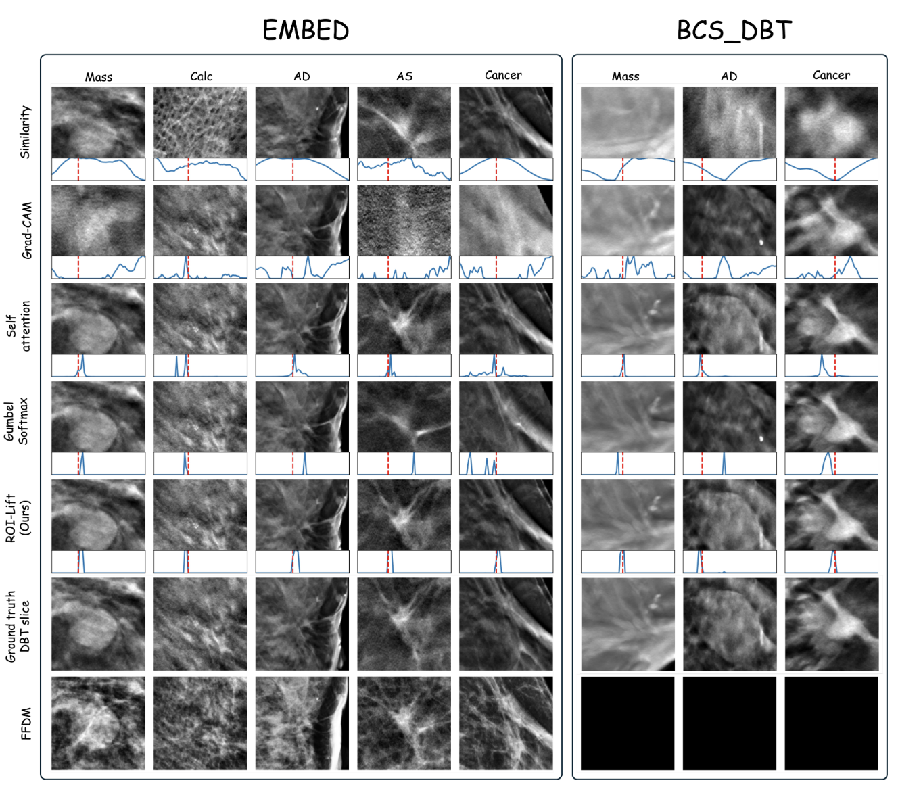

# <div align="center"> ROI-Lift:<br>Learning to Lift the 2D Mammogram ROI to 3D Tomosynthesis ROI without 3D Annotations </div>

[Young Seok Jeon <sup>1</sup>](https://scholar.google.com/citations?user=ppl10bsAAAAJ&hl=en),
Beatrice Brown-Mulry <sup>1</sup>,
Rohan Isaac <sup>1</sup>,
Frank Li <sup>1</sup>,
Christian Fauria-Robinson <sup>1</sup>,
Hao Du <sup>2</sup>,
Theo Dapamede <sup>1</sup>, 
Mohammadreza Chavoshi <sup>1</sup>,
Aawez Mansuri <sup>1</sup>,
Chiratidzo Sanyika <sup>1</sup>,
Judy Gichoya <sup>1</sup>,
Hari Trivedi <sup>1</sup>,
<br/>
<br/>
<sup>1</sup> Department of Radiology, Emory University, Atlanta, GA, USA
<br/>
<sup>2</sup> Beijing University of Aeronautics and Astronautics, Beijing, China 

---

## Model Overview

### Motivation

<p align="center">
    
</p>

<p align="center" style="font-size: 20px;">
    <sub><b>Figure 1.</b> Can AI learn where the lesion lies in depth? Although FFDM allows quick localization of suspicious areas (red box), it often suffers from obscured lesion boundaries caused by overlapping tissue artifacts. DBT addresses this limitation by providing a pseudo-3D view that allows slice-by-slice assessment, but at the cost of nearly doubling reading time. This raises the question: "can we train a model to automatically identify the valid depth region where the lesion lies?"</sub>
</p>

### Method
<p align="center">
    
</p>

<p align="center" style="font-size: 20px;">
  <sub>
    <b>Figure 2.</b> <b>Overview of ROI-Lift.</b>
    ROI-Lift aims to localize the lesion-containing depth region <b>z⁺<sub>loc</sub></b>
    in a DBT patch <b>x<sub>dbt</sub></b>.
    ROI-Lift first maps <b>x<sub>dbt</sub></b> to an embedding <b>z<sub>dbt</sub></b>.
    The Depth Region Sampler maps the embedding to
    <b>p(z⁺<sub>loc</sub> | x<sub>dbt</sub>)</b> using 1D convolutional blocks.
    The depth region <b>z⁺<sub>loc</sub></b> is sampled using the Gumbel–Sigmoid trick.
    Element-wise multiplication between <b>z⁺<sub>loc</sub></b> and <b>z<sub>dbt</sub></b>
    produces the lesion-containing DBT embedding <b>z⁺<sub>dbt</sub></b>, which is used
    to estimate outcomes such as cancer, findings, and the FFDM embedding.
    A lesion-absent embedding <b>z⁻<sub>dbt</sub></b> is generated similarly using
    <b>z⁻<sub>loc</sub></b> and enforces tighter region estimation.
    During inference, only the DBT Encoder and Depth Region Sampler are used.
  </sub>
</p>

### Quantitative Result
<p align="center">
    
</p>

<p align="center" style="font-size: 20px;">
  <sub>
    <b>Figure 3.</b>
    <b>Center Slice Difference (CD) performance comparison on the internal (EMBED) and external (BCS_DBT) datasets.</b>
    The performance of the Similarity method on BCS_DBT is omitted, as the dataset lacks paired FFDM images.
    <b>Best</b> results are shown in <b>bold</b>, and
    <u>second-best</u> results are underlined.
  </sub>
</p>

### Qualitative Result
<p align="center">
    
</p>

<p align="center" style="font-size: 20px;">
  <sub>
    <b>Figure 4.</b>
    <b>Qualitative comparison of ROI-Lift and baseline methods.</b>
    The row “Ground-truth DBT slice” shows DBT patches sampled from the ground-truth slice location.
    Red dotted lines indicate the ground-truth center-slice location.
    ROI-Lift and baseline DBT patches are sampled based on each model’s slice-importance score,
    shown as a blue line.
    The slice-importance scores of the Gumbel-Softmax method appear non–one-hot because a soft-hot
    representation (without straight-through estimation) is used for visualization.
  </sub>
</p>


## Environment Setup
Create a virtual enviroment with python version 3.9

```python
conda create -n roi-lift python=3.9
```
Use requirements.py to setup the environment.
```python
pip install -r requirements.txt
```
Add this project to python path
```python
PYTHONPATH=[this/project/dir]
```
## Data Download
If your goal is only to evaluate ROI-Lift, you can skip downloading EMBED.

### EMBED
We pretrained our model with [Emory Breast Imaging Dataset (EMBED)](https://github.com/Emory-HITI/EMBED_Open_Data) from Emory University, which is one of the current largest Mammography datasets. EMBED contains paired FFDM–DBT exams with 2D ROI annotations, well suited for training our ROI-Lift model.

The dataset requires application to access, which can be done by filling out this [form](https://forms.gle/HwGMM6vdv3w32TKF9).

Download the EMBED dataset [here](https://aws.amazon.com/marketplace/pp/prodview-unw4li5rkivs2#resources).

We strongly encourage users to refer to the [offical EMBED data documentation](https://docs.hitilab.com/en/datasets/embed), if your goal is to reproduce the work or conduct related research.

### BCS_DBT
External evaluation is done with DCS_DBT from DUKE University. The original train–validation–test splits were combined into a single external validation set comprising 435 DBT images, each with
center-slice-labelled ROIs. Unlike EMBED, BCS_DBT lacks FFDM.

Download the BCS_DBT dataset [here](https://wiki.cancerimagingarchive.net/pages/viewpage.action?pageId=64685580).

## Pre-processing
If your goal is only to evaluate ROI-Lift, you can skip EMBED processing.

### EMBED
To process the EMBED dataset, you need to run the three files in order: 
1. `roi_lift/data/process_embed/0_preprocess_csv.ipynb`
2. `roi_lift/data/process_embed/1_preprocess_patch.py` 
3. `roi_lift/data/process_embed/2_process_roi_label.py`

Each file requires manual setup to specify the location where you downloaded the data.

`0_preprocess_csv.ipynb` merges the `meta.csv` and `magview.csv` into a single dataframe and peform a cohort selection thereafter. Please refer to the the paper and code for the inclusion/exclusion criteria.

`1_preprocess_patch.py` performs image pre-processing on the FFDM-DBT pairs in the selected cohort based on `the meta.csv` created in the first step.

`2_process_roi_label.py` extracts ROI data from `meta.csv`.

Your processed data should have the following structure

```
|-dbt_patch
 | |-6212321.npy
 | |-3267563.npy
 | |-2895092.npy
 | |-...
|-mammo_patch
 | |-6212321.npy
 | |-3267563.npy
 | |-2895092.npy
 | |-...
|-mammo_full
 | |-6212321.npy
 | |-3267563.npy
 | |-2895092.npy
 | |-...
 |-dbt_roi.csv
 |-meta.csv
```
### BCS_DBT
To process the BCS_DBT dataset, you need to run two files: 
* `roi_lift/data/process_duke/0_preprocess_csv.ipynb`
* `roi_lift/data/process_duke/1_processs_dbt.ipynb`

Each file requires manual setup to specify the location where you downloaded the data.

`0_preprocess_csv.ipynb` merges the train, validation, and test csv files into a single `meta.csv` file and also processes the ROI labels.

`1_processs_dbt.ipynb` extracts DBT patches and performs several preprocessing steps from the raw DBT DICOM files based on `the meta.csv` created in the first step.

Your processed data should have the following structure

```
|-dbt_patch
 | |-28334095.npy
 | |-33486371.npy
 | |-3375828.npy
 | |-...
 |-meta.csv
```

## Traning ROI-Lift

You can skip this section if you only want infernece.

### Download Mammo-CLIP ckpt

ROI-Lift has a perceptual loss where the embedding is extracted using Mammo-CLIP. Please download Mammo-CLIP ckpt from [here](https://huggingface.co/shawn24/Mammo-CLIP/blob/main/Pre-trained-checkpoints/b2-model-best-epoch-10.tar) and move it to `roi_lift/ckpt/`.

### Training
Run the command in `train.sh`.
```bash
CUDA_VISIBLE_DEVICES=[your/gpu_id] \
PYTHONPATH=$PYTHONPATH:[your/project/dir] \
python roi_lift/train.py \
    --experiment experiment/roi-lift-no-tv
```

## Inference with ROI-Lift

### Download ROI-Lift ckpt

dowload the ROI-Lift checkpoint [here](https://drive.google.com/file/d/10ZS0p7Snou8EgR_GuQIm8XAuYYRW59IK/view?usp=drive_link). and move it to `roi_lift/ckpt`

### Inference
We provide a Jupyter Notebook which runs ROI-Lift on one of BCS_DBT data. The sample data is in `assets/sample`.


## Citation
```
TBU
```

## License and Copyright
This project is licensed under the Creative Commons Attribution–NonCommercial–ShareAlike 4.0 International (CC BY-NC-SA 4.0) license.

You may use, share, and adapt this work for non-commercial research and educational purposes only, provided that you:

Give appropriate credit to the original authors.
Indicate if changes were made.
Distribute any derivative works under the same license (CC BY-NC-SA 4.0).
Commercial use, including model deployment, integration into for-profit products or services, or sale of derivatives, is strictly prohibited.

Copyright © [HITI Lab](https://data.hitilab.com/), 2025
License text: [Creative Commons BY-NC-SA 4.0](https://creativecommons.org/licenses/by-nc-sa/4.0/)

## Contact
For any queries, contact me (Young Seok **Jeon**) (email: youngseokjeon74@gmail.com)


